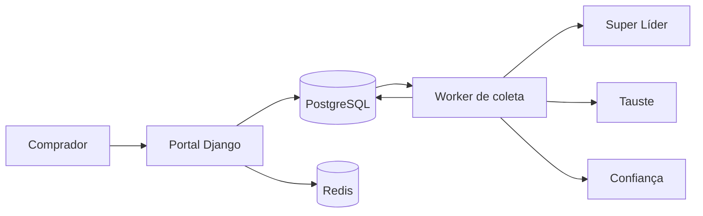
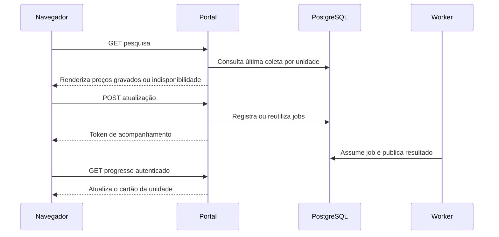
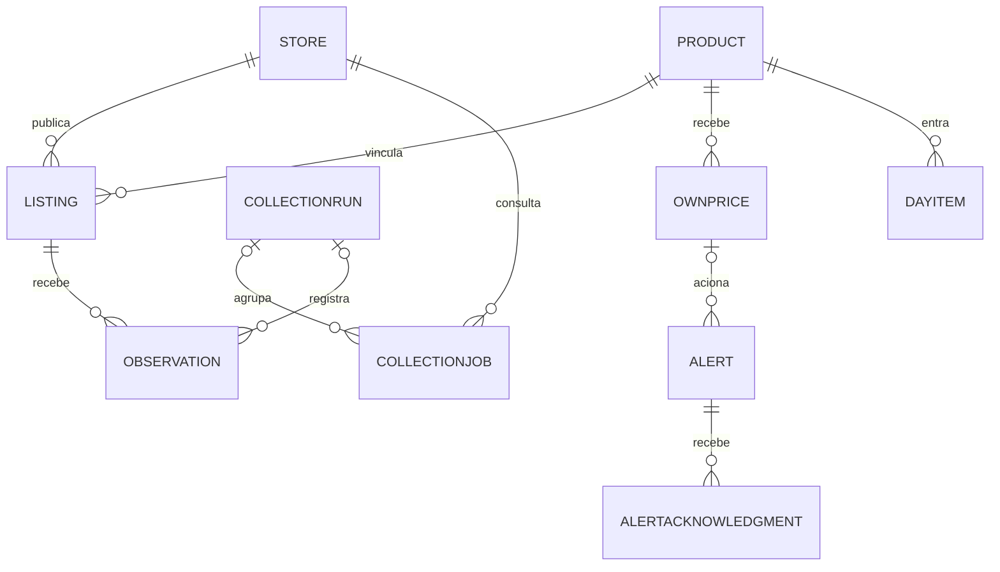

# ADR 0001 · Portal Django e fila em PostgreSQL

O portal preserva os modelos e nomes de tabelas do app Django. A lógica de portal, seleção de preços, fila, acesso e publicação fica em módulos separados no mesmo app. O PostgreSQL guarda a fila e o progresso para que o trabalho sobreviva a reinícios e os resultados possam ser reproduzidos. O Redis guarda contadores compartilhados em produção. A consulta de progresso usa polling autenticado a cada 1,25 s durante uma busca.

O worker usa até três threads no PostgreSQL e serializa as duas unidades do Super Líder por rede. A transação de claim é curta. A operação HTTP ocorre fora dela. Para o volume atual isso reduz o número de serviços em comparação com um broker e um serviço separado de agendamento. O monitoramento registra execuções e pausas de cada rede. A escolha implica manter o worker ativo e acompanhar o crescimento das tabelas de jobs e resultados.

